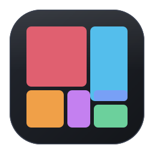

# Spacebox

A fast disk-usage treemap viewer. Point it at a folder and it draws every byte
as a rectangle you can drill into.



```
spacebox            # scan your home directory
spacebox /var       # scan a specific path
spacebox --help
```

- Native FLTK window, no webview or Electron: about **1.7 MB** on disk.
- Scans in the background on a worker thread; the UI stays responsive and the
  scan can be cancelled.
- Click a box to drill in, right-click for Open / Reveal / Copy path / Trash /
  Delete.
- Folders are tinted by whatever they mostly contain, so a media library and a
  source tree are distinguishable at a glance.
- Reports allocated size (real disk usage) or logical size, and groups files
  under 1 MiB per folder so huge trees stay in memory budget.

## Install

### Linux (any distribution)

The installer puts the binary in `~/.local/bin`, registers the desktop entry and
installs the icon set, so Spacebox appears in rofi, wofi, KDE and GNOME launchers.

```bash
git clone <this repo> && cd spacebox
./packaging/install.sh
```

It needs `cargo` and a C/C++ toolchain (`gcc`, `g++`, `cmake`, `pkg-config`,
and the X11/font headers — `libx11-dev`, `libxft-dev`, `libxcursor-dev`,
`libxinerama-dev`, `libxrender-dev`, `libxfixes-dev` on Debian/Ubuntu).

If `spacebox` is not found after installing, or it does not show up in your
launcher, see [Troubleshooting](#troubleshooting).

### macOS

```bash
brew install cmake ninja
cargo build --release
./target/release/spacebox
```

There is no Gatekeeper interplay for a locally built binary. To get a
double-clickable app, `Spacebox.app` can be produced with
[`cargo-bundle`](https://github.com/burntsushi/cargo-bundle); the icon source is
`assets/spacebox.png` (1024 px is ideal; re-render from the SVG with
`rsvg-convert -w 1024 -h 1024 assets/spacebox.svg -o icon-1024.png`).

### Windows

```powershell
cargo build --release
.\target\release\spacebox.exe
```

On a release build the console window is hidden and the exe carries the app
icon and version metadata, so it shows up correctly in Explorer and the
taskbar. To get a Start Menu entry, copy `spacebox.exe` somewhere permanent and
create a shortcut to it.

### Prebuilt binaries

Tagged releases are built by CI for Linux (x86_64, aarch64), Windows (x86_64)
and macOS (Apple silicon, Intel). Download the archive for your platform from
the releases page and put the binary on your `PATH`.

## Packages

`packaging/build-packages.sh` produces installable packages in `dist/`:

```bash
./packaging/build-packages.sh            # every format the host supports
./packaging/build-packages.sh deb rpm    # only these
```

| Format | For | Needs |
| --- | --- | --- |
| `deb` | Debian, Ubuntu, Mint, Pop!_OS | `dpkg-deb` |
| `rpm` | Fedora, RHEL, openSUSE | `rpmbuild` |
| `arch` | Arch, Manjaro, EndeavourOS, CachyOS | `makepkg` |
| `win` | Windows 10/11 x86_64 | mingw-w64 toolchain |

Each package installs `/usr/bin/spacebox`, the desktop entry, the hicolor icon
set and documentation, so the app shows up in launchers as soon as it is
installed.

```bash
sudo apt install ./dist/spacebox_0.1.0-1_amd64.deb
sudo dnf install ./dist/spacebox-0.1.0-1.x86_64.rpm
sudo pacman -U  ./dist/spacebox-0.1.0-1-x86_64.pkg.tar.zst
```

The Windows archive is a zip containing `spacebox.exe`; unzip and run it. The
binary is not code-signed, so SmartScreen will ask for confirmation.

Set `SPACEBOX_MAINTAINER="Name <email>"` to replace the placeholder maintainer
field in the generated control/spec metadata.

### Cross-compiling the Windows exe

```bash
sudo apt install mingw-w64          # Debian/Ubuntu
cargo build --release --target x86_64-pc-windows-gnu
```

The result is a self-contained GUI binary that depends only on standard
Windows system DLLs (`kernel32`, `user32`, `gdi32`, `shell32`, ...). The icon
and version metadata are embedded through `build.rs`, which checks
`CARGO_CFG_TARGET_OS` rather than `cfg!(windows)` so that cross-compiling from
Linux still embeds them.

## Keyboard

| Key | Action |
| --- | --- |
| Arrows | move selection |
| Enter | open folder / reveal file |
| Backspace, Alt+Left | go up one level |
| Delete | move to Trash |
| Shift+Delete | delete permanently |
| Ctrl+C | copy path |
| Ctrl+F | focus search |
| Ctrl+O | choose folder |
| Ctrl+H | scan home |
| Ctrl+R, F5 | rescan |
| Escape | clear selection / cancel scan |
| F1 | shortcut list |

On macOS, `Cmd` works anywhere `Ctrl` does.

## Why it may not show up in rofi

rofi's `drun` mode reads `*.desktop` files from `$XDG_DATA_HOME/applications`
and `$XDG_DATA_DIRS/applications`. It does **not** read your `PATH`, and it will
not find a bare binary in a build directory. A build in `target/release/` is
invisible to every launcher by design.

`packaging/install.sh` fixes that: it copies the binary to `~/.local/bin` and
writes `~/.local/share/applications/io.github.spacebox.desktop` with an absolute
`Exec=` path.

After running it:

```bash
update-desktop-database ~/.local/share/applications
rofi -show drun -dump | grep -i spacebox   # should print one line
```

If it is still missing, check the desktop file validates:

```bash
desktop-file-validate ~/.local/share/applications/io.github.spacebox.desktop
```

## Troubleshooting

**`spacebox: command not found`** — `~/.local/bin` is probably not on `PATH`.
Add `export PATH="$HOME/.local/bin:$PATH"` to your shell rc and start a new
shell.

**A window opens but everything is grey** — a folder with no clear majority
type stays neutral on purpose; deep in a mixed tree that is expected. Drill into
a folder that mostly holds one kind of file.

**`XOpenIM() failed` on stderr** — harmless; the X input method is not available
in that session. Text input still works.

**A very large scan uses a lot of memory** — Spacebox keeps one node per file
above the small-file threshold and one aggregate per folder. Scanning `/` on a
multi-million-file volume costs more than scanning `~`.

## Development

```bash
cargo test          # 22 tests, no display required
cargo build --release
cargo run -- /var   # run against a specific path
```

Layout of the source:

| Path | Purpose |
| --- | --- |
| `src/main.rs` | entry point, CLI flags, window and icon |
| `src/app.rs` | UI state, message loop, command handlers |
| `src/scan/` | directory walker and compact arena |
| `src/treemap/` | squarified layout and painting |
| `src/ui/` | toolbar, sidebar, breadcrumbs, widgets |
| `packaging/` | desktop entry and the install script |
| `assets/` | icon in SVG, PNG and ICO |

## License

MIT. See [LICENSE](LICENSE).
